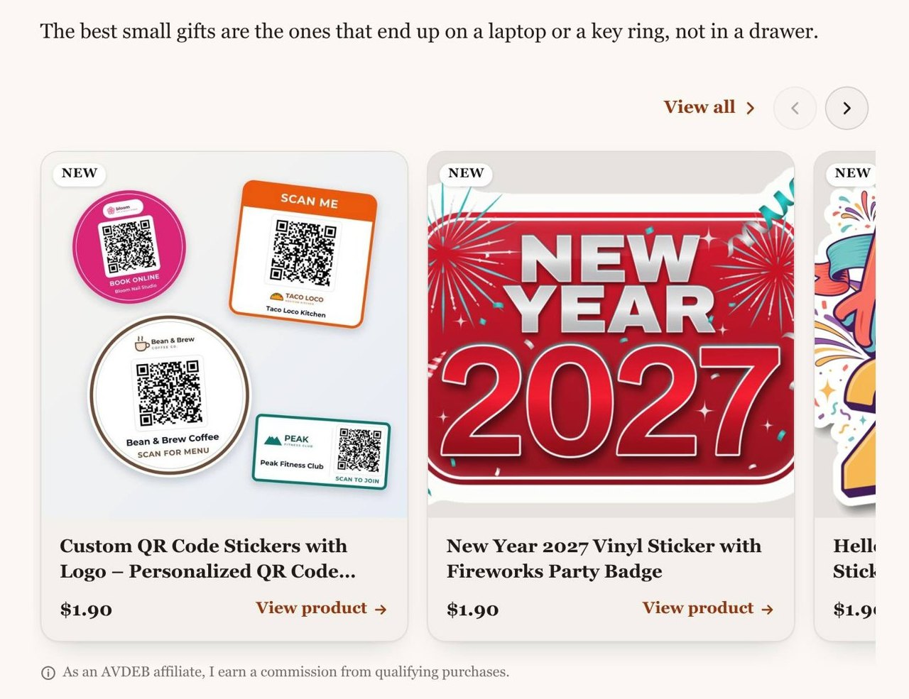

# eleventy-plugin-avdeb

Show [AVDEB](https://avdeb.com/developers/#eleventy) products on your Eleventy site (a creator's shop, a category, a search or a single product) with **your affiliate referral code on every link**.



- **In Markdown:** write `{avdeb-products https://avdeb.com/category/stickers/ layout="carousel"}` in any post. No template changes needed.
- **In templates:** ``, `` and `` shortcodes for Nunjucks, Liquid, 11ty.js and WebC.
- **Four layouts:** grid, carousel (scroll-snap with keyboard and arrow buttons), list ("shop the post") and spotlight. Single products render as a horizontal card, a hero or a compact card, with your own badge and note.
- **Fits your design:** container queries let embeds adapt to the column they sit in. Choose inherit, light, dark or system theme, plus card style, accent colour, radius and image shape. Styles use `:where()` (zero specificity), so your CSS always wins, and `--avdeb-*` custom properties restyle everything. Or use the `avdebData` filter for your own markup.
- **Static and fast:** products are fetched at build time and written into your HTML. No client-side API calls, no layout shift. The CSS and the ~50-line carousel script are loaded only on pages that show products.
- **Resilient builds:** responses are cached in `.cache/avdeb` between builds. If AVDEB can't be reached, the last good copy is used for a week, and a failed embed never breaks your build.
- **Honest links:** referral links get `rel="sponsored"`, and an optional affiliate disclosure appears under embeds that carry a code.
- **Private by default:** no third-party scripts, cookies, iframes or tracking. Your secret key is only used at build time.

## Requirements

- Eleventy 3.0 or later
- Node.js 18 or later

## Installation

```sh
npm install eleventy-plugin-avdeb
```

```js
// eleventy.config.js
import avdeb from "eleventy-plugin-avdeb";

export default function (eleventyConfig) {
	eleventyConfig.addPlugin(avdeb, {
		refCode: "YOURCODE",
	});
}
```

## Configuration

Your referral code is added as `?ref=` to every AVDEB link. Instead of putting it in the config, you can set environment variables (or put them in a `.env` file next to your config; it's read automatically):

```sh
AVDEB_REF_CODE=YOURCODE
# Optional: with a secret key your code is added automatically and embeds can show up to 48 products (12 without).
AVDEB_SECRET_KEY=avdeb_sk_…
```

Keep the secret key out of git. It's only sent to `api.avdeb.com` at build time and never appears in your pages.

All options:

| Option | Default | |
| --- | --- | --- |
| `refCode` | `AVDEB_REF_CODE` | Your referral code |
| `apiKey` | `AVDEB_SECRET_KEY` | Secret key (`avdeb_sk_…`) |
| `layout` | `"grid"` | `grid`, `carousel`, `list`, `spotlight` |
| `columns` | `3` | 1–6 (narrow columns get fewer automatically) |
| `cardStyle` | `"elevated"` | `elevated`, `outline`, `minimal` |
| `theme` | `"site"` | `site` (inherit your colours and fonts), `light`, `dark`, `auto` |
| `accentColor` | AVDEB green | Hex colour for buttons and highlights |
| `radius` | `16` | Corner radius in px (0–32) |
| `imageRatio` | `"square"` | `square`, `portrait`, `landscape` |
| `ctaLabel` | `"View product"` | Button text on cards |
| `showPrice`, `showCreator`, `showBadges` | `true` | Card details |
| `newTab` | `false` | Open product links in a new tab |
| `showDisclosure` | `true` | Affiliate disclosure under embeds that carry a code |
| `disclosureText` | "As an AVDEB affiliate, I earn a commission from qualifying purchases." | |
| `cacheMinutes` | `360` | How long fetched products stay fresh (5–2880) |
| `cacheDirectory` | `".cache/avdeb"` | Product cache between builds; `false` keeps it in memory |
| `locale` | `"en-US"` | Price formatting |
| `assets` | `true` | Copy `avdeb.css`/`avdeb.js` to the output and link them on pages with embeds |
| `assetsUrl` | `"/assets/avdeb/"` | Where the assets are served from |
| `transform` | `true` | Replace `{avdeb-…}` tags in every HTML page |

### Become an AVDEB affiliate

Free to join: 5% commission, 30-day cookie, monthly PayPal payouts in USD ($50 minimum), open worldwide.
Apply at [avdeb.com/affiliate/apply](https://avdeb.com/affiliate/apply/). After approval, copy your referral code (or create a secret key) in the [partner dashboard](https://avdeb.com/affiliate/dashboard/developers/).

## Usage

### Tags in Markdown

Write a tag on its own line in any post:

```text
{avdeb-products https://avdeb.com/creators/cleo/ layout="carousel" limit="8" heading="From my shop"}
{avdeb-products https://avdeb.com/category/stickers/ layout="list" limit="3"}
{avdeb-products cat stickers columns="4"}
{avdeb-product https://avdeb.com/store/custom-qr-code-keychain/ variant="hero" badge="Editor's pick" note="I use it every day."}
{avdeb-button href="/creators/cleo/" label="Visit my shop" variant="outline" align="center"}
```

The first value is a creator, category or product link (detected automatically) or search words. A tag alone in a paragraph replaces the whole paragraph. Tags work in any HTML page Eleventy writes, including content from a CMS or data files.

To show a tag as text, wrap it in an extra pair of braces: `{{avdeb-products}}`. In Markdown processed by Liquid or Nunjucks, put it inside `…`.

### Shortcodes

Nunjucks:

```njk





```

Liquid takes a link, or the same options as a tag:

```liquid




```

Options: `url`, `creator`, `tag`, `type`, `q` (leave all empty for the newest products), `limit`, `layout`, `columns`, `heading`, `intro`, `headingLevel`, `viewAll`, `cardStyle`, `theme`, `accent`, `radius`, `ratio`, `buttonText`, `hidePrice`, `hideCreator`, `newTab`, `locale`. For a single product: `variant` (horizontal, hero, card), `badge`, `note`. For a button: `href`, `label`, `variant` (solid, outline, link), `align` (start, center, end). Option names also work in kebab-case (`card-style`, `hide-price`).

### Your own markup

```njk

<ul>
  
    <li><a href="{{ card.href }}" rel="{{ card.rel }}"> {{ card.title }} — {{ card.price }}</a></li>
  
</ul>
<small>{{ result.disclosure }}</small>
```

Each card has `href` (with your referral code), `rel`, `target`, `title`, `image`, `width`, `height`, `price`, `compareAt`, `discount`, `isNew` and `creator`. Raw products are in `result.products`, the "view all" link in `result.viewAll`.

In JavaScript data files or `.11ty.js` templates, use the runtime directly:

```js
// _data/picks.js
import { createAvdeb } from "eleventy-plugin-avdeb";

export default async function () {
	const avdeb = createAvdeb({ refCode: "YOURCODE" });
	return (await avdeb.data({ creator: "cleo", limit: 4 })).cards;
}
```

### Filters

- `avdeb` renders tags inside any string: `{{ item.body | avdeb | safe }}`.
- `avdebStrip` removes tags (for feeds and excerpts): `{{ post.content | avdebStrip }}`.
- `avdebData` returns products and cards (above).

## Styling

Every rule is `:where()`-wrapped, so your CSS wins. Set tokens in your stylesheet:

```css
.avdeb {
	--avdeb-accent: #7c3aed;
	--avdeb-radius: 4px;
	--avdeb-card-bg: #fff;
	--avdeb-font-title: Georgia, serif;
}
```

Tokens: `--avdeb-accent`, `--avdeb-accent-contrast`, `--avdeb-surface`, `--avdeb-card-bg`, `--avdeb-card-pad`, `--avdeb-border`, `--avdeb-muted`,
`--avdeb-badge-bg`, `--avdeb-badge-text`, `--avdeb-shadow`, `--avdeb-shadow-hover`, `--avdeb-radius`, `--avdeb-ratio`, `--avdeb-gap`, `--avdeb-pad`,
`--avdeb-font-title`, `--avdeb-heading-size`, `--avdeb-title-size`, `--avdeb-price-size`, `--avdeb-btn-bg`, `--avdeb-btn-color`, `--avdeb-btn-shadow`.

The markup uses stable BEM classes (`.avdeb`, `.avdeb--{layout}`, `.avdeb-card`, `.avdeb-card__title`, `.avdeb-card__price`, `.avdeb-btn`…) and `.not-prose`, so Tailwind Typography leaves it alone.

To bundle the stylesheet yourself, set `assets: false` and import `eleventy-plugin-avdeb/avdeb.css` (and optionally `eleventy-plugin-avdeb/avdeb.js`). Carousels still scroll without the script. With a `pathPrefix`, add Eleventy's HTML `<base>` plugin so the asset links get the prefix.

## How it works

- At build time the plugin calls `https://api.avdeb.com/v1/catalog/products`. With a secret key, requests send `Authorization: Bearer avdeb_sk_…` and the API returns links that already carry your code; without one, `?ref=` is added to every link.
- Each query is fetched once per build, however many pages use it, and cached in `.cache/avdeb/catalog.json`. Fresh results are reused for `cacheMinutes`; a failed request falls back to the last good result (up to a week old) and retries after 15 minutes. Delete the folder to refresh products right away. On Netlify, Vercel or GitHub Actions, cache `.cache` between builds to keep the fallback.
- Prices change, so rebuild your site regularly (a daily scheduled build is plenty).
- All product data is validated before rendering: only `https://avdeb.com` links and `https://` images get through, and every value is escaped.

## Development

```sh
npm test               # unit tests and an Eleventy build test (no network)
npm run demo           # demo blog with the plugin → http://localhost:8080
```

## Support

Issues and ideas: [github.com/Avdebcom/eleventy-plugin-avdeb/issues](https://github.com/Avdebcom/eleventy-plugin-avdeb/issues). More integrations: [avdeb.com/developers](https://avdeb.com/developers/).

## License

MIT © AVDEB
